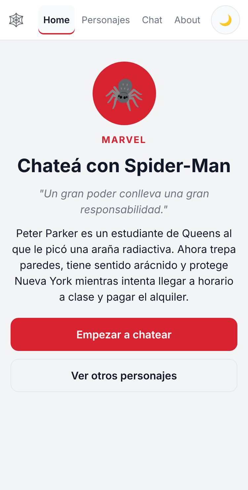
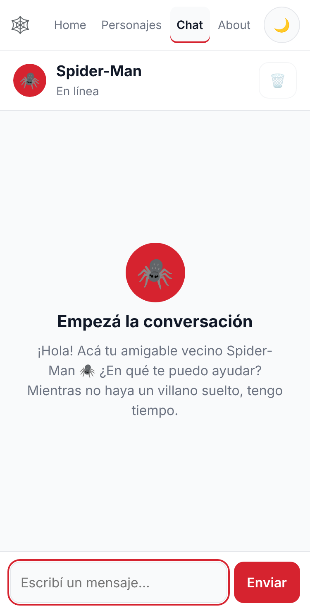
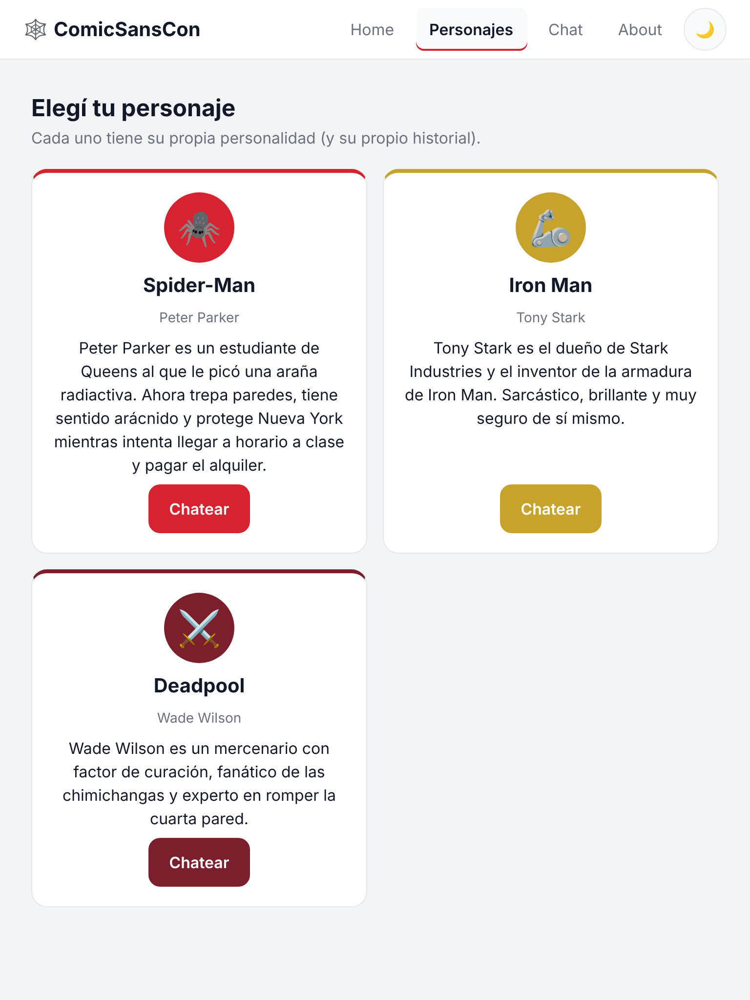
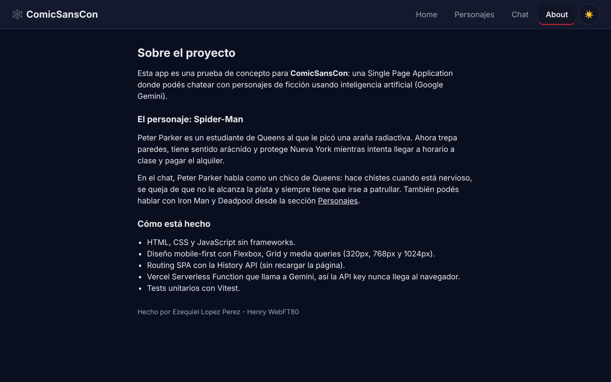
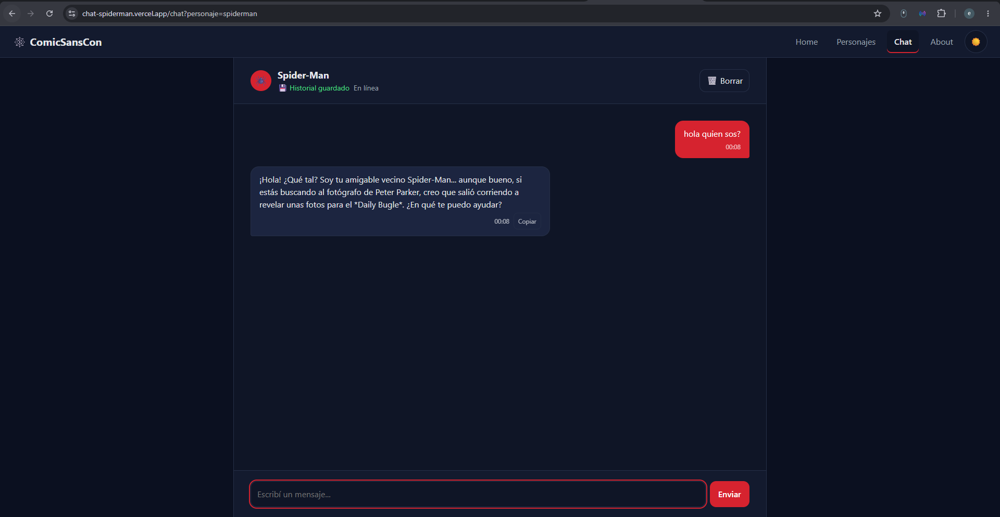

# Chateá con Spider-Man 🕷️

Proyecto Integrador M3 - Henry Full Stack (WebFT80)

Alumno: **Ezequiel Lopez Perez**

Aplicación desplegada: https://chat-spiderman.vercel.app

## Descripción

Single Page Application hecha para **ComicSansCon** (prueba de concepto) donde podés chatear con personajes de Marvel usando **Google Gemini**. La app es responsive mobile-first, tiene routing con la History API y se conecta a Gemini a través de una **Vercel Serverless Function**, así la API key nunca queda expuesta en el navegador.

## El personaje: Spider-Man (Peter Parker)

Elegí a **Spider-Man** de Marvel. Peter Parker es un estudiante de Queens al que le picó una araña radiactiva: tiene fuerza, agilidad, sentido arácnido y trepa paredes. Vive con su tía May, saca fotos para el Daily Bugle y se guía por la frase de su tío Ben: *"un gran poder conlleva una gran responsabilidad"*.

En el chat habla como un chico de 20 años: relajado, nerd y haciendo chistes cuando está nervioso. Se queja de que no le alcanza la plata, menciona a sus villanos (Duende Verde, Doctor Octopus, Venom) y no revela su identidad secreta así nomás.

El system prompt (en `api/_personajes.js`) le indica:
- Personalidad, historia y forma de hablar.
- Responder corto (1 a 3 oraciones), porque es un chat.
- Responder siempre en español y nunca decir que es una IA.
- Mantener contenido apto para todo público.
- Tener en cuenta lo que se habló antes en la conversación.

Como extra también se puede chatear con **Iron Man** (Tony Stark) y **Deadpool** (Wade Wilson), cada uno con su propio prompt.

## Funcionalidades

**Vistas (rutas):**
- `/home`: presentación de Spider-Man y botón para empezar a chatear.
- `/chat`: el chat. Con `?personaje=ironman` o `?personaje=deadpool` se cambia de personaje.
- `/about`: información del proyecto y del personaje.
- `/personajes`: galería de personajes (extra credit).
- Cualquier otra ruta muestra una página 404.

**Chat:**
- Mensajes del usuario a la derecha (oscuros) y del personaje a la izquierda (claros).
- Input con botón Enviar (también se envía con Enter).
- Estado "está escribiendo..." animado mientras Gemini responde.
- Estado vacío al entrar y estado de error con botón **Reintentar** si falla la API.
- Scroll automático al último mensaje, con scroll interno solo en el panel de mensajes.
- Se manda todo el historial (últimos 20 mensajes) en cada pedido para que el personaje tenga contexto.

**Routing SPA:**
- Navegación sin recargar la página usando `history.pushState`.
- Los botones atrás/adelante del navegador funcionan (evento `popstate`).
- Si entrás directo a `/chat` o `/about` también funciona (Vercel redirige todo a `index.html`, ver `vercel.json`).

**Responsive (mobile-first):**
- Base: 320px en adelante.
- Tablet: `@media (min-width: 768px)`, con más padding, la galería en 2 columnas y las burbujas al 75%.
- Desktop: `@media (min-width: 1024px)`, con el contenido centrado con `max-width: 64rem`, la galería en 3 columnas y las burbujas al 60%.

### Extra credit

Hice las tres opciones:

1. **Historial en localStorage**: la conversación se guarda y se carga al recargar. Hay un botón para borrar el historial y un indicador "💾 Historial guardado".
2. **Varios personajes**: galería con Spider-Man, Iron Man y Deadpool. Cada uno tiene su propio system prompt y su propio historial.
3. **Funcionalidades adicionales**: hora en cada mensaje, "escribiendo..." animado, enviar con Enter, botón para copiar las respuestas y modo oscuro/claro (se guarda la preferencia).

## Estructura del proyecto

```
chat-spiderman/
├── api/
│   ├── functions.js       # serverless function (proxy a Gemini)
│   ├── _gemini.js         # armar el pedido y parsear la respuesta de Gemini
│   └── _personajes.js     # system prompts de cada personaje
├── src/
│   ├── index.html
│   ├── styles.css
│   ├── app.js             # routing y vistas
│   ├── chat.js            # lógica del chat y fetch a la API
│   ├── personajes.js      # datos de los personajes para el front
│   └── utils.js           # funciones de transformación de datos
├── tests/
│   ├── utils.test.js
│   ├── app.test.js
│   └── functions.test.js
├── docs/capturas/
├── .env.example
├── .gitignore
├── vercel.json
├── package.json
└── README.md
```

Los archivos de `/api` que empiezan con `_` no se publican como funciones en Vercel. Los usé para separar código que importa `functions.js`.

## Cómo funciona la conexión con Gemini

```
Navegador  --POST /api/functions-->  Vercel Function  --(con API key)-->  Gemini
           { personajeId, mensajes }                    system prompt + historial
           <------- { respuesta } ------------------- <-------- texto --------
```

1. El front manda el `personajeId` y el historial (`[{ role: 'user' | 'model', text }]`).
2. La función valida los datos, busca el system prompt del personaje y arma el body con `system_instruction` y `contents`.
3. Llama a Gemini con la key en el header `x-goog-api-key`, leída de `process.env.GEMINI_API_KEY`.
4. Saca el texto de `candidates[0].content.parts` y lo devuelve.

Configuración usada: `temperature: 0.9` (para que el personaje sea más creativo) y `maxOutputTokens: 1024`. Si Gemini devuelve 429 (rate limit), la app muestra un mensaje para esperar y reintentar.

## Requisitos

- [Node.js](https://nodejs.org) 18 o más.
- Una API key de Gemini (gratis), que se saca en https://aistudio.google.com/apikey
- Vercel CLI: `npm install -g vercel`

## Cómo ejecutarlo local

1. Clonar el repo e instalar dependencias:

   ```bash
   git clone https://github.com/lopezeze/chat-spiderman.git
   cd chat-spiderman
   npm install
   ```

2. Crear el `.env` copiando el ejemplo:

   ```bash
   cp .env.example .env
   ```

   Y poner tu key:

   ```
   GEMINI_API_KEY=tu_api_key
   ```

   `GEMINI_MODEL` es opcional. Si no se pone, se usa `gemini-3.5-flash-lite`.

3. Levantar el proyecto con Vercel (así también corre la serverless function):

   ```bash
   vercel dev
   ```

   La primera vez pide iniciar sesión y vincular el proyecto. Después queda en `http://localhost:3000`.

> Importante: no sirve abrir `index.html` con Live Server, porque la carpeta `/api` solo funciona con `vercel dev` o en Vercel.

## Tests

```bash
npm test
```

Hay 36 tests con **Vitest**, y el `fetch` está mockeado así no se usa la red ni la API key real:

- `tests/utils.test.js`: crear mensajes, formatear la hora, validar el texto, transformar el historial al formato de la API, leer el historial de localStorage (incluso si está roto) y leer el personaje de la URL.
- `tests/app.test.js`: el routing (`/` va a `/home`, las rutas válidas y el 404) y `enviarMensajeAPI` con fetch mockeado (respuesta ok, error del servidor, sin internet y respuesta vacía).
- `tests/functions.test.js`: el parseo de la respuesta de Gemini (incluido sacar los asteriscos del markdown), el armado del body, las validaciones y el handler (405, falta la key, personaje inválido, respuesta ok, 429 y error de Gemini). También se chequea que la key vaya en el header y no en la URL.

## Deploy en Vercel

1. Subir el proyecto a GitHub (el `.env` no se sube porque está en el `.gitignore`).
2. Entrar a https://vercel.com, tocar **Add New... > Project** e importar el repo.
3. En **Framework Preset** dejar **Other**. No hace falta build command.
4. En **Environment Variables** agregar `GEMINI_API_KEY` con tu key (y `GEMINI_MODEL` si querés cambiar el modelo).
5. Tocar **Deploy**.
6. Probar que funcione el chat y entrar directo a `/chat` y `/about` para chequear las rutas.

Si cambiás una variable de entorno después, hay que hacer **Redeploy** para que la tome.

También se puede hacer desde la terminal:

```bash
vercel          # deploy de prueba
vercel --prod   # deploy a produccion
```

## Capturas

| Home (mobile) | Chat vacío (mobile) |
|---|---|
|  |  |

| Personajes (tablet) | About en modo oscuro (desktop) |
|---|---|
|  |  |

Chat funcionando en producción (Vercel + Gemini):



## Tecnologías

- HTML, CSS y JavaScript (ES modules, sin frameworks)
- History API, Fetch API, async/await
- Google Gemini API
- Vercel Serverless Functions
- Vitest
